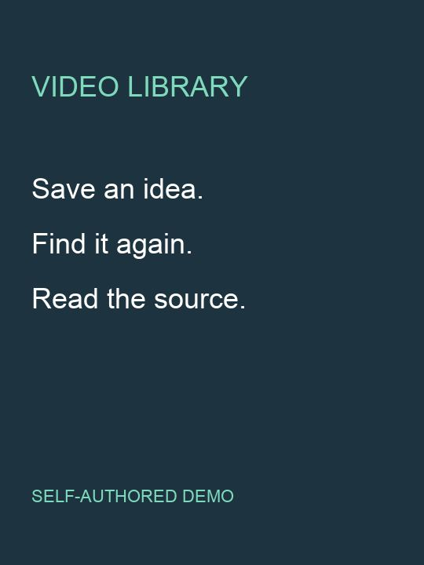

# 演示：把收藏变成可检索的素材

> 自制演示：这是离线测试输出，链接与平台ID为合成测试值，不是线上采集结果。

| 信息 | 内容 |
| --- | --- |
| 备用编号 | S0001 |
| 主分类 | 学习方法 |
| 作者 | 项目自制演示 |
| 发布时间 | 2026-11-15T00:00:00+08:00 |
| 点赞数（采集时） | 不适用（合成样例） |
| 采集时间 | 2026-11-15T23:36:50+08:00 |
| 原始链接 | [打开原视频](https://www.xiaohongshu.com/explore/0123456789abcdef01234567) |
| 分享链接 | 见原始链接 |
| 收纳状态 | 资料已获取 |

## 作者发布的笔记文案

这是项目自制语音样例，页面链接和ID仅用于离线格式测试，不存在真实平台采集结果。

## 视频音频文字稿

转写方式：自制无字幕视频真实音轨本地Whisper识别，未全文人工听校

[00:00–00:03] This is an original recording for a video library test.

[00:03–00:07] Today I learned that saving a video is only the first step.

[00:07–00:13] A useful library also needs a clear title, a readable transcript, and a way to find the

[00:13–00:14] material again.

[00:14–00:18] I organize examples by the problem they help me solve.

[00:18–00:21] I check the original source before I reuse an idea.

[00:21–00:24] This recording has no subtitles.

[00:24–00:29] The final sentences, clear records make useful knowledge easier to find.

## 我的参考备注

